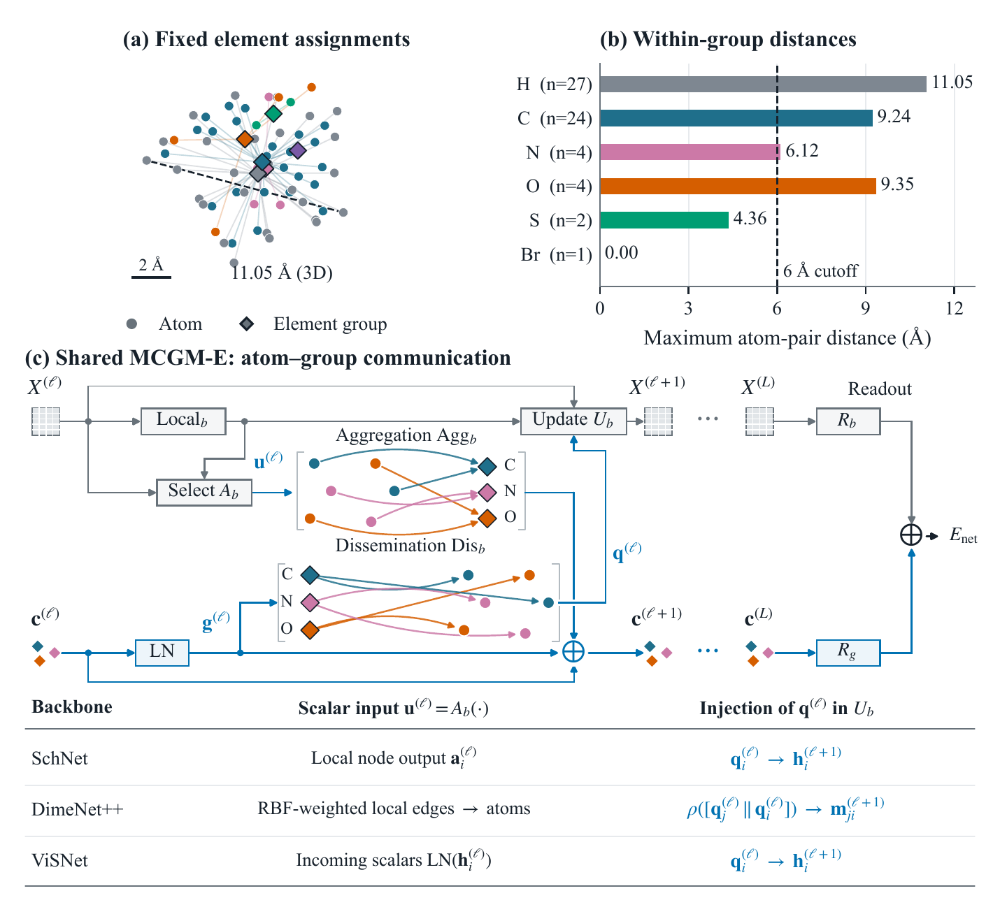
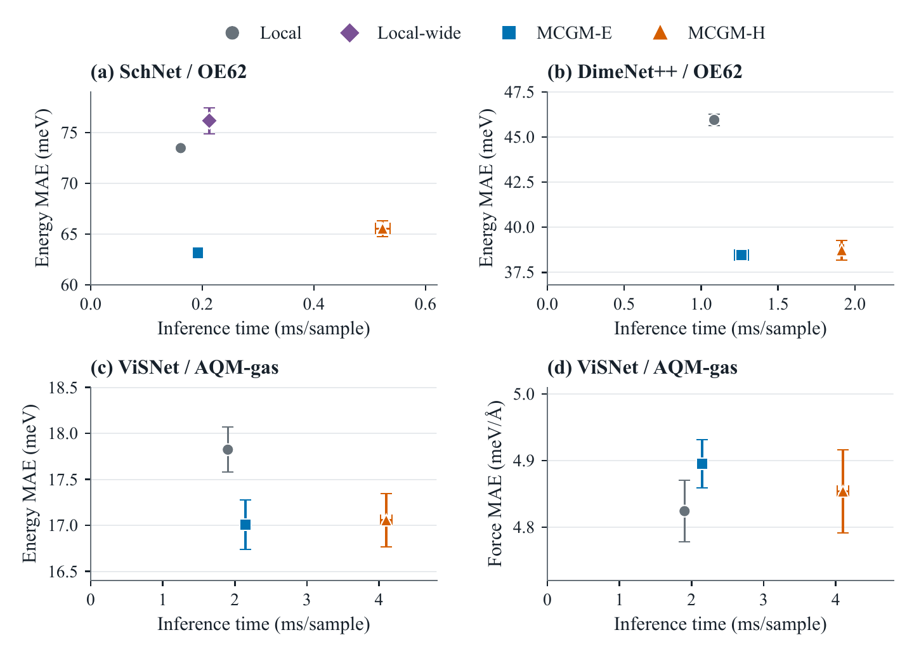
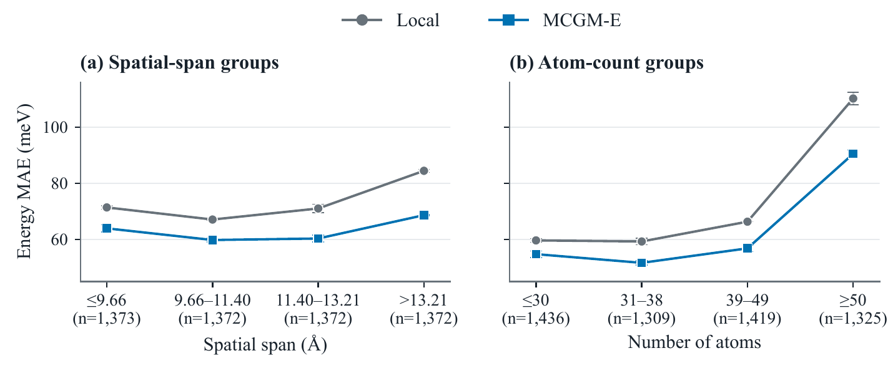

# MCGM: Element-Guided Cross-Scale Communication for Molecular Energy Prediction

This project page contains the manuscript abstract and selected figures. Model code, preprocessing and split-generation scripts, experiment configurations, and principal model checkpoints will be released upon acceptance.

## Abstract

Molecular energy models need representations that combine local atomic geometry with information from more distant environments. We introduce Multi-Stage Clustered Global Modeling (MCGM), whose primary configuration, MCGM-E, augments geometric graph neural networks with persistent element-group states. Within each molecule, atoms of the same element share a group state. Fixed assignments define sparse communication paths, while distance-aware aggregation and dissemination update the group states and return their context to the local backbone across interaction blocks. We implement the pathway in SchNet, DimeNet++ and ViSNet. For SchNet on OE62, with the composition-dependent energy reference fitted only to training molecules, adding the complete MCGM-E pathway lowers the mean absolute error in test energies from 73.99 to 62.86 meV across three training seeds, a 15.0% reduction relative to the local control. These results support the complete MCGM-E pathway as a useful complement to SchNet's local geometric representations for molecular energy prediction.

## Method overview

MCGM-E maintains one group state for each element present within a molecule. Distance-aware aggregation updates the next group state, while dissemination reads the normalized incoming group state and injects context into the backbone. Atomic and group-level readouts jointly predict energy.

## Main result: SchNet on OE62

The composition-dependent energy reference is fitted only to the 50,000 training molecules and held fixed for validation and testing. Test energy mean absolute errors (MAEs) are reported as means and sample standard deviations over three training seeds.

| Configuration | Test energy MAE (meV) |
| --- | ---: |
| SchNet Local | 73.99 ± 0.93 |
| SchNet + MCGM-E | 62.86 ± 0.72 |

Adding the complete MCGM-E pathway reduces the mean test energy MAE by **15.0%** relative to Local.

## Additional comparisons

The following plots use full-data reference fits: one composition-dependent reference per dataset is fitted before splitting, using the target energies of the training, validation and test structures. Timing uses checkpoints trained with these references.

Energy and force errors versus inference cost under the full-data reference fit. Vertical bars show sample standard deviation across three training seeds; horizontal bars show timing sample standard deviation across five complete-test passes of a fixed trained model. The SchNet panel includes a parameter-matched widened local control. ViSNet timing includes energy and forces. Comparisons are made within each panel.

SchNet energy errors across OE62 molecular-size groups under the full-data reference fit, with groups defined by spatial span or atom count. Each point summarizes three training seeds; all 5,489 test molecules are included.

