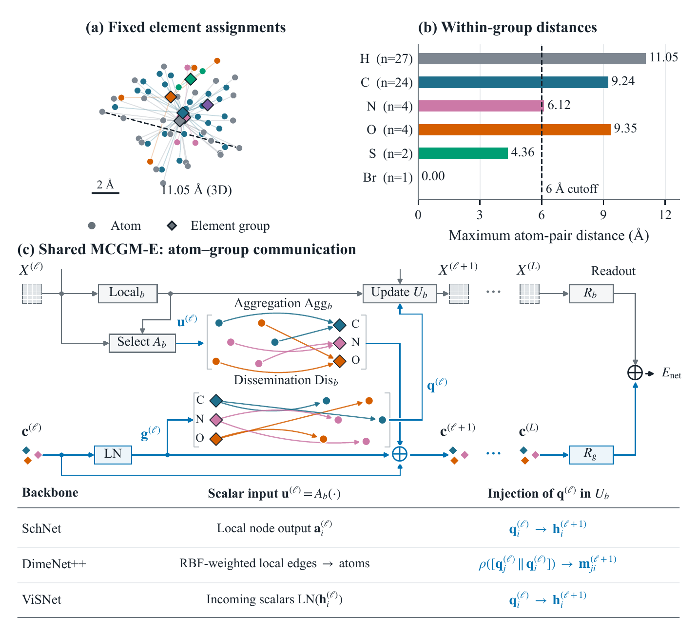
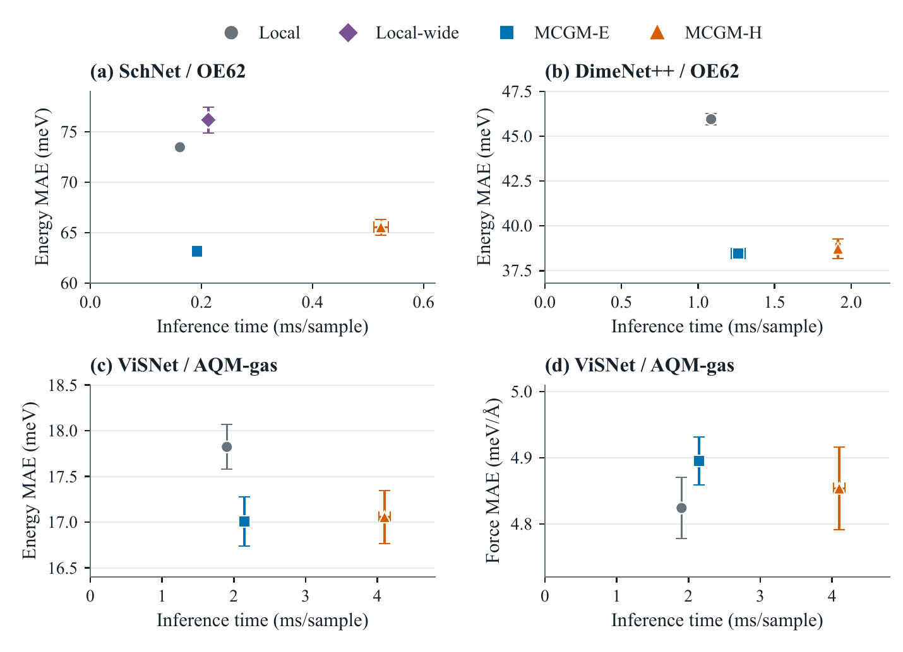
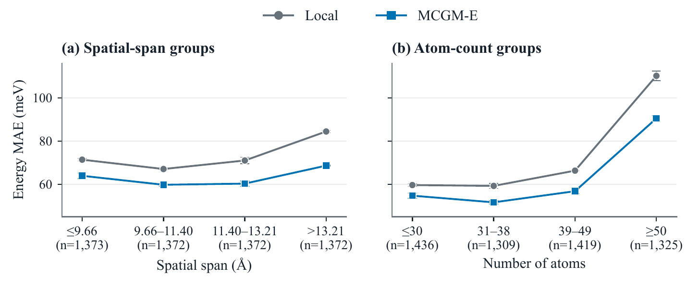

# MCGM: Element-Guided Cross-Scale Communication for Molecular Geometric Graph Learning

This project page contains the manuscript abstract and selected figures. Model code, preprocessing and split-generation scripts, experiment configurations, and principal model checkpoints will be released upon acceptance.

## Abstract

Accurate molecular energy prediction relies on representations of atomic species and three-dimensional structure. However, repeated aggregation over local neighborhoods can make it difficult for geometric graph neural networks to retain and integrate information from distant atomic environments. We propose Multi-Stage Clustered Global Modeling (MCGM) to complement local geometric processing with persistent element-group states. In its primary configuration, MCGM-E, atoms of the same element within each molecule share a group state, providing a common communication route between distant environments while keeping summaries of different elements separate. Each atom has one fixed group assignment, yielding sparse communication paths. Distance-aware aggregation collects backbone features into the group states, which are retained and updated across interaction blocks. Dissemination feeds this accumulated context into later backbone updates, making non-local information available during representation learning. MCGM-E reduces energy mean absolute error (MAE) by 4.6% to 16.3% for SchNet and DimeNet++ on OE62 and ViSNet on AQM-gas, relative to the corresponding local controls.

## Method overview

MCGM-E maintains one group state for each element present within a molecule. Distance-aware aggregation updates the next group state, while dissemination reads the normalized incoming group state and injects context into the backbone. Atomic and group-level readouts jointly predict energy.

## Selected results

Energy and force errors versus inference cost. Vertical bars show sample standard deviation across three training seeds; horizontal bars show timing sample standard deviation across five complete-test passes of a fixed trained model. The SchNet panel includes a parameter-matched widened local control. ViSNet timing includes energy and forces. Comparisons are made within each panel.

SchNet energy errors across OE62 molecular-size groups, defined by spatial span or atom count. Each point summarizes three training seeds; all 5,489 test molecules are included.

